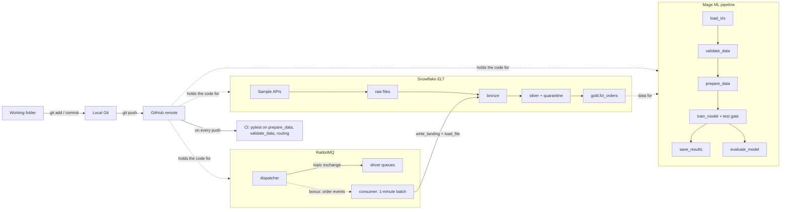

# freshcart-pipelines

Data Engineering assignment *From Git to Gold*: Git + CI, a FreshCart ELT pipeline on Snowflake, a Mage ML pipeline, and a RabbitMQ food-order stream.

```
freshcart-pipelines/
├── README.md
├── .gitignore                  # .env, *.pkl, *.csv, mage.log, __pycache__/ ...
├── requirements.txt            # what CI installs
├── elt/freshcart_elt.ipynb     # Part B (+ bonus)
├── iris_project/               # Part C (Mage project + iris_pipeline_colab.ipynb)
├── stream/                     # Part D (dispatcher.py, driver.py, stream_colab.ipynb, bonus_publisher.py)
├── tests/                      # pytest tests run by CI
├── docs/                       # RUNBOOK.md, REPORT_TEMPLATE.md
└── .github/workflows/ci.yml
```

## How the pieces fit together



## Secrets
No passwords in Git. Snowflake credentials come from environment variables / Colab Secrets (`.env.example` lists the names); the broker URL comes from `AMQP_URL`.

See `docs/RUNBOOK.md` for the step-by-step order.
